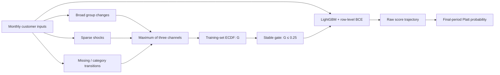

# SG-TR: stable-state gated credit risk scoring

**When customer inputs are stable, encourage consistent scores. When inputs change, preserve room to respond.**

[中文介绍](README.zh-CN.md) · [Method](docs/method.md) · [Results & provenance](docs/results.md) · [Interview guide](docs/interview-guide.zh-CN.md)

SG-TR studies the stability–responsiveness trade-off in monthly credit risk scoring. It adds a temporal penalty to a LightGBM raw-margin objective **only on input-stable adjacent months**. State construction uses feature changes, not labels, model scores or SHAP.

## The result in one minute

On a **30,000-customer, same-source locked holdout**, with zero overlap with the 15,000 development customers:

| Outcome | SG-TR relative to the same-objective M0_ref baseline |
|---|---:|
| Stable-state raw-score volatility reduction | **29.18%**; 95% percentile bootstrap CI **28.57–29.82%** |
| High-change response retained | **87.43%**; CI **86.84–88.01%** |
| Final-period AUC difference | **−0.000230**; CI **[−0.000606, 0.000129]** |
| Platt-calibrated Log Loss relative change | **+0.4320%** |
| Platt-calibrated Brier relative change | **+0.2451%** |

All five frozen holdout acceptance conditions were met. The improvement is selective temporal consistency, with a measurable response and probability-quality cost—not universal dominance or a Kaggle leaderboard claim.


*Figure regenerated from frozen aggregate tables. Dynamic metrics use uncalibrated raw scores; probability metrics use one final-period observation per customer. Bootstrap resamples customers, paired across models, 2,000 times. [Full definitions and results](docs/results.md).*

## What this project demonstrates

- **Risk modeling:** customer-level final labels, monthly-row training, final-period customer evaluation.
- **Leakage control:** customer-disjoint outer 5-fold / inner 3-fold validation; state mappings fitted inside each training split.
- **Custom optimization:** state-gated pairwise penalty, analytic gradients and a diagonal Hessian approximation.
- **Model governance:** fixed thresholds and parameter, customer-paired uncertainty, calibration separated from temporal evaluation, locked same-source validation.
- **Interpretability:** OOF dynamic SHAP audits the link between input changes, attribution changes and score changes.

These are project capabilities. Individual authorship and collaboration credits will be listed after the maintainer confirms them.

## How it works



$$
\mathcal L=\sum_{i,t}\operatorname{BCE}(y_i,\sigma(f_{it}))
+0.03\sum_{(i,t)\in E}\mathbf1(G_{it}\le0.25)(f_{it}-f_{i,t-1})^2.
$$

Edges connect consecutive natural months for the same customer. Non-stable rows still contribute to the classification loss. The final feature-state definition and Q25 gate were frozen before the formal holdout model results were observed.

## Run a data-free demonstration

Python 3.10+ and NumPy are sufficient. From this repository root:

```bash
python -m pip install -e .
python examples/synthetic_demo.py
python -m unittest discover -s tests -v
python scripts/check_public_bundle.py
```

The demonstration uses **synthetic customers, labels, margins and state percentiles**. It exercises adjacency, gating, loss and derivative calculations. It does not train a production model, reconstruct the three-channel mapper, or reproduce the AMEX results.

To redraw the published aggregate figure:

```bash
python -m pip install matplotlib
python scripts/render_results.py
```

## Repository map

| Path | Purpose |
|---|---|
| `src/sgtr_demo/` | Small, tested pedagogical implementation of the objective and pair construction |
| `examples/` | Synthetic-only walkthrough; no private inputs |
| `tests/` | Finite-difference, gating, adjacency and metric-unit tests |
| `research_reference/` | Reviewed source snapshots for reading the actual research implementation |
| `results/` | Aggregate result tables only; no customer-level predictions |
| `docs/` | Method, evidence, limitations and technical interview guide |
| `.github/workflows/` | Synthetic checks; no training data or credentials required |

**Reproduction status:** the demo and result-figure commands are runnable; the research snapshots are reference code, not a self-contained end-to-end AMEX pipeline. Data access, original feature selection and frozen split artifacts require a separate, permitted research setup. See [reproduction levels](docs/reproducibility.md).

## Scope and related methods

The contribution is a **credit-scoring problem formulation and validated combination** of input-state gating, selective temporal regularization and state-stratified evaluation. Temporal consistency, graph smoothness, hard gates and SHAP all have prior art. The literature audit identifies Ouyang et al., TCSR, DeepTCSR, Temporal-SCL and TC-λ as direct methodological neighbors; see [method positioning](docs/method.md).

Stable and High describe **input change**, not low and high default risk. This is a same-source customer holdout, not external or cross-time validation. The main classification loss is row weighted; customer-balanced training is a robustness analysis. Anonymous variables limit business interpretation, and dynamic SHAP provides model attribution rather than causal effects.

## Data, licensing and release status

No AMEX raw records, customer identifiers, row-level scores, trained models, full-text third-party papers or unpublished manuscript are included. Obtain data through the [original competition](https://www.kaggle.com/competitions/amex-default-prediction) under its applicable terms.

Code is available under the [MIT license](LICENSE); [scope and data exclusions](NOTICE.md) apply. Maintained by [zwxzwxzwxlalala-cell](https://github.com/zwxzwxzwxlalala-cell). This is the v0.1.0 portfolio release: a runnable synthetic objective demonstration, audited aggregate evidence and research code reading snapshots.

If you use this work, link to the repository and identify the version. Formal citation metadata will be added once authorship and publication information are confirmed.
