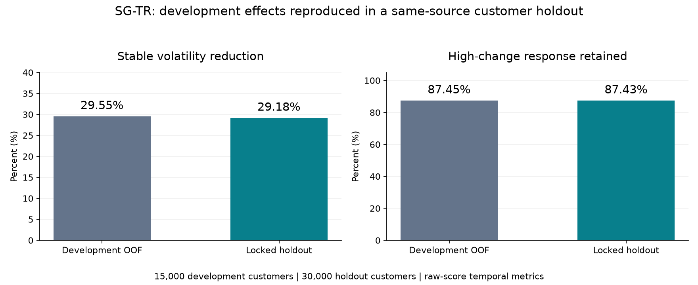

# SG-TR：稳定状态门控的动态信用风险评分

**输入稳定时增强评分一致性，输入变化时保留模型响应空间。**

[English](README.md) · [方法说明](docs/method.md) · [结果与来源](docs/results.md) · [项目深挖](docs/interview-guide.zh-CN.md)

这个项目研究月度信用风险评分的**稳定性—响应性权衡**：全局平滑可以压低评分波动，也会压低客户状态变化时的响应。SG-TR 使用独立于标签、模型评分和 SHAP 的输入状态指标，仅对 Stable 相邻账期施加 raw score 时间一致性约束。

## 先看核心证据

在与15,000名开发客户零重叠的 **30,000名同源锁定留出客户**中：

| 指标 | 相对同一自定义目标路径的 M0_ref |
|---|---:|
| Stable层 raw score 波动下降 | **29.18%**；95% percentile bootstrap置信区间 **28.57%–29.82%** |
| High层响应保留 | **87.43%**；区间 **86.84%–88.01%** |
| 客户真实末期 AUC 差 | **−0.000230**；区间 **[−0.000606, 0.000129]** |
| Platt后 Log Loss 相对变化 | **+0.4320%** |
| Platt后 Brier 相对变化 | **+0.2451%** |

五项预先冻结的留出验收条件均满足。概率损失和响应幅度的代价与稳定性收益一并报告。这不是比赛榜单成绩，也不代表所有指标全面提升。



图来自冻结汇总表；动态指标使用校准前 raw score，末期预测一人一次。完整数表、2,000次客户级配对bootstrap区间和来源哈希见[结果说明](docs/results.md)。

## 招聘者可以从哪里看能力

| 能力 | 项目中的证据入口 |
|---|---|
| 金融风控建模 | 最终客户标签与月度行的层级区分、末期评价、AUC/KS/概率质量 |
| 数据挖掘方法 | 三通道状态建模、选择性正则、梯度与Hessian对角项、消融 |
| 验证与防泄漏 | 客户级外5折/内3折验证，训练折拟合状态映射 |
| 统计判断 | 客户等权动态指标、配对bootstrap、负结果与代价分析 |
| 模型治理与解释 | 核心冻结、独立概率校准、OOF动态SHAP、锁定留出验证 |
| 工程质量 | 合成演示、单元测试、来源清单、公开包白名单检查 |

这里列的是项目证据。个人负责范围和合作贡献将在作者确认后明确列出，不默认全部独立完成。

## 三分钟查看方法

月度输入 → Broad／Sparse Shock／Transition → 三通道最大值 → 训练经验分位 G → Stable门控 → LightGBM raw score轨迹。

最终门控固定 `G <= 0.25`，时间正则系数固定 `λ = 0.03`。Stable边加入相邻评分差平方惩罚；Medium、High边不附加该惩罚。所有训练行仍参与分类损失。

Platt只负责客户真实末期的概率尺度，稳定性和响应性继续用校准前评分评价。[完整方法与近邻比较](docs/method.md)

## 无真实数据也能运行

Python 3.10+；从仓库根目录执行：

```bash
python -m pip install -e .
python examples/synthetic_demo.py
python -m unittest discover -s tests -v
python scripts/check_public_bundle.py
```

演示只使用合成客户、标签、评分和状态分位，展示相邻边、门控、目标函数及导数。它不复现正式AMEX研究指标，也不重新构造完整三通道映射。

目录分为：`src/`小型演示实现、`tests/`测试、`research_reference/`真实研究源码阅读快照、`results/`正式汇总结果、`docs/`方法与深挖文档。[复现范围](docs/reproducibility.md)

## 研究定位

本项目的增量是纵向信用评分中的问题组合与验证设计，而非首次提出时间一致性、图平滑或Hard Gate。Ouyang、TCSR、DeepTCSR、Temporal-SCL、TC-λ等直接近邻在方法文档中正面讨论。

Stable／High表示输入变化程度，不表示风险高低。留出验证仍来自同一数据源；月度记录共享客户最终标签；主损失按行训练；动态SHAP描述模型归因而非因果效应。

## 公开范围

本候选包不含原始数据、客户ID、逐行预测、模型文件、第三方论文全文和未发表论文全文。数据应由读者通过[原始比赛页面](https://www.kaggle.com/competitions/amex-default-prediction)按适用条款自行获取。

代码采用 [MIT许可证](LICENSE)，授权范围见 [NOTICE](NOTICE.md)。维护账号为 [zwxzwxzwxlalala-cell](https://github.com/zwxzwxzwxlalala-cell)。本版定位为v0.1.0项目展示：合成演示、正式汇总证据与研究代码阅读快照。作者署名与个人贡献确认后再补充。
